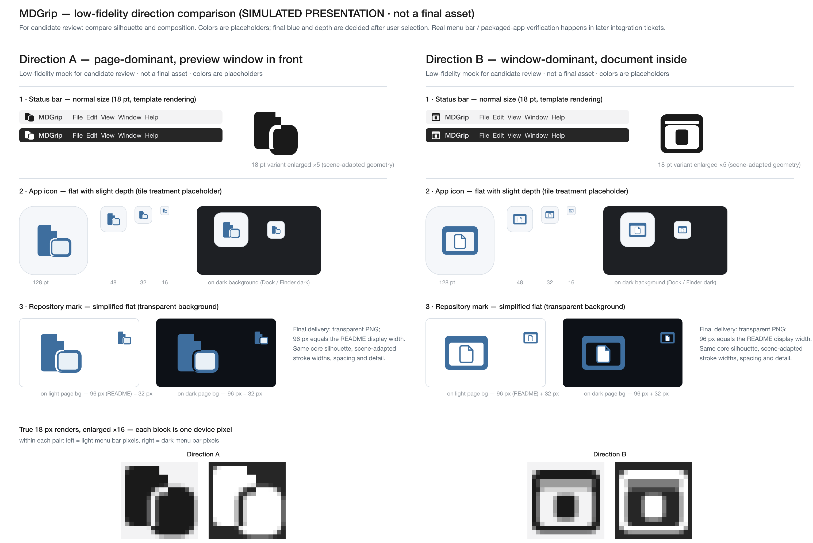

# MDGrip 视觉候选 · 低保真方向评审（票据 01）

> **模拟展示 · 低保真 · 非最终资产**。本目录是候选评审材料，不是已接入的运行时资源；未做真实菜单栏、Finder/打包 App 或浏览器标签验收。等待用户选定方向后（票据 02）才进行精修、色值确认与接入。

## 图片查看入口

- **对比图（直接查看）**：`compare-a-vs-b.png`（3040 × 2032，按 2× Retina 渲染，含真实 18 px 像素放大条）
- **可编辑源文件（独立 SVG，可直接在浏览器/预览打开）**：
  - `direction-a.svg` — 方向 A 场景板
  - `direction-b.svg` — 方向 B 场景板
- 每张场景板自包含，均展示同一方向在三个场景的表现：
  1. 状态栏正常尺寸（18 pt）：浅色 / 深色菜单栏条模拟 + 18 pt 适配几何的放大视图
  2. App 图标：128 / 48 / 32 / 16 pt tile 模拟 + 深色背景下的 tile
  3. 仓库标记：浅色 / 深色页面底色，96 px（即 README 显示宽度）+ 32 px

## 两个方向的构图

| | 方向 A「叠窗」 | 方向 B「容窗」 |
|---|---|---|
| 构图 | 竖版文档页主导，横版预览窗从页面右下角**前方**叠出（遮挡关系，页面被"咬"出一角，缝隙分离） | 横版预览窗主导（顶部栏带 + 边框），竖版文档页**居中放在**窗口内容区（包含关系） |
| 外轮廓 | 竖版块 + 右下突出的窗块（右上另有折角台阶） | 横版圆角块（窗） |
| 文档特征 | 强（大面积页面 + 右上折角） | 弱（居中较小的文档页 + 折角） |
| 预览窗特征 | 中（小窗在前，无栏带细节） | 强（栏带 + 边框 + 内容区） |

## 比较重点与本票未定事项

- **比较重点 = 轮廓与构图**（上表 + 各场景渲染图），不是色彩：两方向当前使用同一组**占位色**（克制蓝 `#3E6E9E` 家族 + 中性灰白），最终蓝色色值、App 图标"轻微层次"的深浅与 tile 处理（含是否改为蓝色底 tile）均**尚未确定**，留待用户选定方向后在票据 02 精修评审中确认。
- 两方向均满足 spec 的共同约束：无文字的"文档与预览窗口融合"几何符号、原创图形（不复用/改造上游 shield + 字母风格的现有 favicon）、同一核心轮廓按场景适配线宽、留白与细节（缝隙和折角用透明镂空表达，浅/深背景自适应）。

## 18 pt 小尺寸观察（真实渲染 ×16，两方向具体差异）

以下观察来自对**真实 18 px 渲染**再放大 16 倍（`-scale 1600%`，288 px）的像素条（compare 底部，每格 = 一个设备像素），不是矢量放大：

- **方向 A @18 px**：呈"两个正块"——页面块 + 窗块；页面**折角在 18 px 保留**为一个约 2 px 的小台阶缺口；预览窗的栏带细节在 18 px **已省略**。两块形体的分离依靠约 1–2 px 的透明缝隙，在浅色底上缝隙呈浅灰细线，区分成立但较紧密。
- **方向 B @18 px**：呈"一个框块"——外轮廓为横版窗块，顶部栏带以一条透光横线与内容区分；文档**折角在 18 px 已省略**，文档缩小为约 5 × 6 px 的居中正块。框 / 内容 / 文档三层级比 A 多一层，中央小块偏小，"文档"识别依赖该小块与顶部栏线。
- 浅 / 深菜单栏互为反色时（模拟观察），两方向均保持可读；方向 A 的缝隙在深色底上同样可见。
- 更大尺寸（App / 仓库）下差异更明显：A 的文档特征更强，B 的窗口特征更强；这是两个方向的主要取舍点。

## 模拟展示边界

- 菜单栏条、App tile、页面底色均为**绘制背景**的模拟构图；不代表真实 macOS template 着色、真实 Finder / DMG 打包产物或浏览器标签显示，这些属于票据 03 / 04 / 05 / 07 的实际验收。
- 本票未修改 `macos/`、`README.md`、`defaults/`（favicon、页脚）或任何运行时资源；无永久测试。
- 上游现状参考：现有 `defaults/static/images/favicon.ico` 为 shield + 字母 "M" 风格的字标徽章；两个候选方向均刻意避开盾形 / 字母字标词汇（spec：不复用或改造上游图标，图标不含文字）。

## 渲染与观察环境

- 工具：`rsvg-convert 2.62.2`（SVG → PNG）、`ImageMagick 7.1.2-29`（像素放大与拼装）；macOS arm64。
- 场景板 PNG 渲染：`rsvg-convert -z 2 direction-a.svg -o a.png`（2× Retina 表示正常显示尺寸）。
- 18 px 像素条：将 18 pt 适配几何按真实 18 × 18 px 渲染后用 ImageMagick `-scale 1600%` 放大 16 倍（18 px → 288 px；对比图整体为 2× Retina 渲染）。
- 观察方式：对上述渲染 PNG 的直接查看；观察文字以渲染图为准，用户应以本地图片查看为准。

## 下一步

- **已选定方向 A（2026-10-11，用户原话"选 A"）**：选择记录见 [`../selection.md`](../selection.md)。
- ~~请用户在两个方向中明确选定一个~~（已完成）；选定后仅沿方向 A 精修四类资产并确认色值与层次（票据 02），方向 B 不保留为运行时可切换方案。
